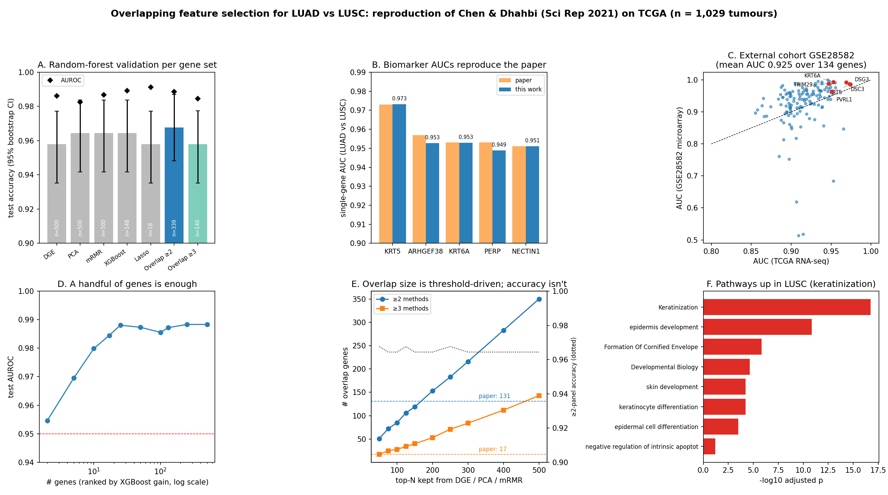

# TCGA lung subtype classifier: overlapping feature selection for LUAD vs LUSC

[](https://github.com/HarshaP22/tcga-lung-subtype-classifier/actions/workflows/ci.yml)

[](LICENSE)

An end-to-end bioinformatics and machine-learning project on **1,139 TCGA lung samples**.
It adapts and extends the workflow of Chen & Dhahbi (2021), *"Lung adenocarcinoma and lung squamous
cell carcinoma cancer classification, biomarker identification, and gene expression
analysis using overlapping feature selection methods"*, **Scientific Reports** 11:13323
([DOI: 10.1038/s41598-021-92725-8](https://doi.org/10.1038/s41598-021-92725-8)).



**Result.** A 339-gene overlap panel achieved **96.8% accuracy (299/309 test
samples) and AUROC 0.989** on the saved binary split. Several alternative panels
correctly classified 298/309 samples, so the small difference does not establish
superiority. Individual-gene discrimination was assessed in an independent
microarray cohort; the full multigene classifier was not externally validated.

**Study scope.** This is an educational bioinformatics ML portfolio and an
adapted reproduction, with documented validation limitations. Start with the
[current validation assessment](docs/VALIDATION.md) and the
[project research guide](docs/pdf/PROJECT_GUIDE.pdf) for interpretation of the
saved results. Three-class prediction and survival findings are exploratory.

## Start here

| If you want… | Go to |
|---|---|
| The current study guide and limitations | [Research guide](docs/pdf/PROJECT_GUIDE.pdf), [validation assessment](docs/VALIDATION.md) |
| The results in five minutes | [`notebooks/walkthrough.ipynb`](notebooks/walkthrough.ipynb), rendered on GitHub with outputs |
| The full analysis and interpretation | [`docs/REPORT.md`](docs/REPORT.md) ([PDF](docs/pdf/REPORT.pdf)) |
| How each model works, and a leakage audit | [`docs/MODELS.md`](docs/MODELS.md) ([PDF](docs/pdf/MODELS.pdf)) |
| A plain-language story of the project | [`docs/BLOG.md`](docs/BLOG.md) ([PDF](docs/pdf/BLOG.pdf)) |
| To run it yourself | [Reproduce](#reproduce), below |

---

## Skills demonstrated

**Bioinformatics**
- **Public genomics data engineering.** TCGA STAR counts and a gencode probeMap from the
  GDC hub on UCSC Xena, plus an Affymetrix series and platform annotation from GEO. Handled
  GDC's HTSeq→STAR retirement and resolved gencode v36 vs v22 Ensembl version mismatches,
  which recovered 93% of IDs instead of 53%.
- **RNA-seq normalization.** Inverted Xena's log2(x+1) back to counts, applied a
  count-per-million filter, then edgeR-style TMM + log2-CPM. The docs explain why TPM is the
  wrong choice for cross-sample ML.
- **TCGA sample semantics.** Decoded barcodes to separate primary tumour (`-01`) from
  normal (`-11`) and to group samples by patient.
- **Differential expression** with BH-FDR and log-fold-change thresholds.
- **Pathway enrichment.** GO, KEGG and Reactome over-representation analysis against an
  expressed-gene background.
- **Cross-platform validation.** RNA-seq biomarkers checked on a microarray cohort after
  collapsing probes to genes.
- **Survival analysis.** Kaplan–Meier curves, log-rank tests and Cox proportional hazards
  on TCGA clinical data.
- **Biological interpretation.** Findings tied to squamous-epithelial biology (keratins,
  desmosomes, nectins), p53 signalling and MUC1.

**Machine learning**
- **Feature selection across five paradigms:**
  - univariate statistics (DGE)
  - unsupervised projection (PCA)
  - a relevance/redundancy filter (a custom mRMR variant using ANOVA and correlation)
  - tree-ensemble importance (XGBoost)
  - sparse linear modelling (L1 logistic regression with the 1-SE rule)

  These are combined by ensemble voting.
- **Leakage-aware evaluation:**
  - a patient-level stratified binary split reused across feature panels
  - hyperparameters tuned by in-train 5-fold CV
  - 10,000-replicate bootstrap confidence intervals
  - an explicit [leakage audit](docs/MODELS.md#8-leakage-audit-read-this-before-trusting-any-number)
- **Models:** grid-searched binary random forests, a fixed three-class random forest, XGBoost, L1 logistic
  regression and single-gene ROC classifiers.
- **Interpretability:** exact TreeSHAP, a feature-count ablation curve, and stability
  selection.
- **Robustness:**
  - sensitivity analysis of the overlap to selector thresholds
  - a within-subgroup confound audit (sex)
  - unsupervised substructure (hierarchical clustering + silhouette)
- **Engineering:**
  - a modular, seeded, resumable pipeline
  - memory-lean preprocessing, peaking at 1.8 GB on 60k × 1.1k matrices
  - a synthetic-data test suite in CI
  - pinned dependencies and a one-command downloader

---

## The idea in one paragraph

Each feature-selection method fails in its own way:
- DGE produces outlier-driven false positives.
- XGBoost overfits.
- LASSO is unstable when genes are collinear.
- PCA is hard to interpret.
- mRMR is greedy.

The paper motivates selecting genes supported by multiple methods. These methods
share the same training samples, so their agreement is not independent confirmation
and does not guarantee that their weaknesses cancel out. Genes chosen
by ≥2 methods drive classification and pathways. Genes chosen by ≥3 are the candidate
biomarkers.

## Results

Random-forest validation (patient-level 7:3 split, 5-fold CV, LUAD = positive,
10k-bootstrap CI):

| Gene set | #genes | Accuracy (95% CI) | Sens | Spec | F | AUROC |
|---|---|---|---|---|---|---|
| DGE | 500 | 0.958 (0.935–0.977) | 0.987 | 0.927 | 0.960 | 0.986 |
| PCA | 500 | 0.964 (0.942–0.984) | 0.994 | 0.933 | 0.966 | 0.982 |
| mRMR | 500 | 0.964 (0.942–0.984) | 1.000 | 0.927 | 0.967 | 0.987 |
| XGBoost | 148 | 0.964 (0.942–0.984) | 1.000 | 0.927 | 0.967 | 0.989 |
| LASSO (1-SE) | 18 | 0.958 (0.935–0.977) | 0.975 | 0.940 | 0.960 | 0.991 |
| **Overlap ≥2** | **339** | **0.968 (0.948–0.987)** | 1.000 | 0.933 | **0.970** | 0.989 |
| Overlap ≥3 | 140 | 0.958 (0.935–0.977) | 0.994 | 0.920 | 0.960 | 0.985 |

- **Biomarkers vs the paper:**
  - KRT5 0.973 (paper 0.973)
  - KRT6A 0.953 (0.953)
  - NECTIN1 0.951 (0.951)
  - ARHGEF38 0.953 (0.957)
  - PERP 0.949 (0.953)
- **External single-gene assessment:** GSE28582 mean AUC 0.925 across 134 separate genes; KRT6A 0.994, DSC3
  0.993, KRT5 0.988.
- **Pathways:** keratinization and cornified envelope are up in LUSC, along with a
  p53/DNA-damage term. GTPase signalling, migration and O-glycan processing are up in LUAD.
- **Three-class task (LUAD / LUSC / Normal):** macro-F1 0.957 with the 339-gene panel, vs
  0.964 with all 15,686 genes.
- **Ablation:** 10 genes already reach 0.980 AUROC and 17 reach 0.984; the curve plateaus
  at about 25 genes.
- **Exploratory survival:** KRT6A (unadjusted log-rank p = 0.003) and KRT17
  (p = 0.016) show LUAD associations. Neither meets BH q < 0.05 when correcting
  across all 280 saved log-rank tests; see [validation](docs/VALIDATION.md).
- **Exploratory candidates:** DSG3, CERS3, SERPINB13, BNC1 and the lncRNA MIR205HG. Selection frequencies vary. These are hypothesis-generating candidates, not
  established novel biomarkers.
- **Sensitivity:** overlap size depends on selector depth. The top ~150–175 genes per
  ranked selector reproduce the paper's ≈131, and the top 50 gives exactly 17 in ≥3 methods.
  Accuracy stays at 0.964–0.968 throughout.

**Documented deviations from the paper:**
- STAR counts instead of the retired HTSeq counts
- a Welch-test stand-in for edgeR
- Enrichr libraries instead of DAVID
- TCGA/lifelines instead of KM-Plotter

Details and their effects are in [REPORT §9](docs/REPORT.md#9-documented-deviations-from-the-paper).

---

## Reproduce

```bash
git clone https://github.com/HarshaP22/tcga-lung-subtype-classifier.git
cd tcga-lung-subtype-classifier
python -m venv .venv && source .venv/bin/activate
pip install -r requirements.txt

make test        # about 1 minute: runs the pipeline on synthetic data, no downloads
make data        # about 250 MB of public TCGA / GEO / Enrichr files (docs/DATA.md)
make reproduce   # steps 0-7 on the real data
```

The pipeline is seeded end to end (`SEED = 42`), and each stage caches its outputs, so a
rerun resumes where it stopped. Steps whose optional inputs are missing are skipped with a
message.

## Pipeline

| Step | Script | What it does |
|---|---|---|
| 0 | `src/00_preprocess.py` | Invert log2, merge cohorts, CPM filter, Ensembl→symbol, TMM + log2-CPM |
| 1 | `src/01_feature_selection.py` | Five selectors on the training split → overlap (≥2 / ≥3 / all 5) |
| 2 | `src/02_classification.py` | Grid-tuned random forest per gene set, bootstrap CIs, heatmaps, confusion matrices |
| 3 | `src/03_biomarkers_roc.py` | Single-gene ROC/AUC on TCGA + external GSE28582 validation |
| 4 | `src/04_pathways.py` | GO / KEGG / Reactome enrichment, up vs down in LUSC |
| 5a | `src/05a_three_class.py` | LUAD / LUSC / Normal |
| 5b | `src/05b_shap_ablation.py` | TreeSHAP + AUROC vs number of genes |
| 5c | `src/05c_survival.py` | Kaplan–Meier + Cox on TCGA clinical data |
| 5d | `src/05d_novel.py` | Stability selection, under-reported candidates, confound audit, clustering |
| 6 | `src/06_sensitivity.py` | Overlap sensitivity to selector thresholds |
| 7 | `src/07_summary_figure.py` | The six-panel figure above |

Shared settings (seed, split ratio, thresholds, paper reference values) live in
`src/config.py`. Normalization, metrics and IO helpers are in `src/utils.py`.

## Repository layout

```
├── README.md              you are here
├── notebooks/
│   └── walkthrough.ipynb  guided tour of the results (pre-executed)
├── docs/
│   ├── REPORT.md          full results, sensitivity analysis, deviations
│   ├── MODELS.md          every model: settings, rationale, leakage audit
│   ├── VALIDATION.md      current limitations and next validation steps
│   ├── BLOG.md            plain-language write-up
│   ├── DATA.md            what each input file is and where it comes from
│   └── pdf/               PDF versions for sharing
├── src/                   pipeline, steps 00-07 + config.py, utils.py
├── results/
│   ├── figures/           summary, ROC, heatmaps, SHAP, Kaplan–Meier, pathways, …
│   └── tables/            every metric behind the figures, as CSV / JSON
├── tests/                 synthetic cohort + end-to-end smoke test (run in CI)
├── data/                  empty in git; filled by download_data.sh
├── download_data.sh       one-command fetch of all public inputs
├── Makefile               test / data / reproduce targets
├── requirements.txt       pinned runtime dependencies
├── requirements-dev.txt   test and notebook tooling
├── CITATION.cff           how to cite this repo and the original paper
└── LICENSE                MIT
```

Results are committed on purpose, so every figure and number can be inspected on GitHub
without running anything. Raw data is not committed: it's public, large, and re-downloadable.

## Citation and attribution

If you use this code, please cite the original study. GitHub's "Cite this repository"
button (from [`CITATION.cff`](CITATION.cff)) gives both references. The anchor paper is
© its authors under CC-BY; its text and metadata were retrieved via PubMed Central. This
repository is an adapted reproduction, released under the [MIT License](LICENSE).
